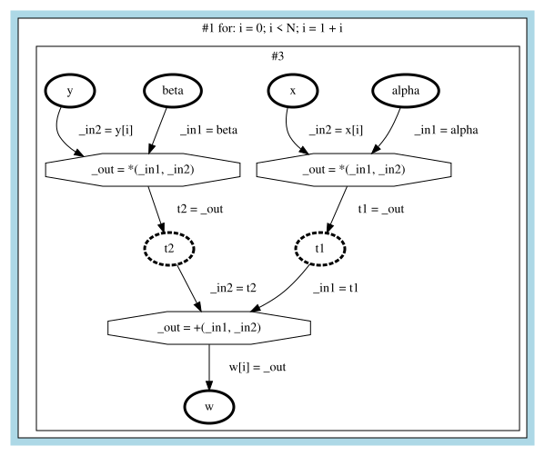

docc represents programs as **stateful dataflow multigraphs (SDFGs)**, a data-centric intermediate representation introduced by [DaCe](https://github.com/spcl/dace). An SDFG makes data movement explicit: every read and write of memory is an edge in a graph. This is what makes data dependencies, parallelism, and transfers between host and device easy to analyze.

docc works on **Structured SDFGs**, in which control flow is a tree of loops, branches, and sequences instead of an arbitrary graph. A Structured SDFG consists of three parts:

1. **Data**: named containers and symbols,
2. **Control flow**: a tree of control flow nodes,
3. **Dataflow**: a small graph inside each leaf of the tree (a *block*) that computes something.

## SDFG and Structured SDFG

The original SDFG describes control flow as a state machine: states, each with a dataflow graph, connected by edges with conditions and symbol assignments (`sdfg/include/sdfg/control_flow/`). This can represent any control flow, including `goto`, which is why the C/C++ frontend lifts LLVM IR into this form first. It then *structurizes* the state machine into a Structured SDFG.

The Python and PyTorch frontends build Structured SDFGs directly. All analyses, passes, transformations, and the code generator work on Structured SDFGs.

## Data

**Containers** are named pieces of data. A container is either an *argument* of the function or *transient*, that is, local to the SDFG. Its type is one of:

| Type        | Example                          | Description                                                                 |
| ----------- | -------------------------------- | --------------------------------------------------------------------------- |
| `Scalar`    | `Scalar(PrimitiveType.Float)`    | A single value of a primitive type: `Float`, `Double`, `Half`, `Int64`, `Bool`, … |
| `Pointer`   | `Pointer(Scalar(...))`           | A pointer to memory, for example a C array or a NumPy buffer                |
| `Array`     | `Array(Scalar(...), "N")`        | A fixed-size array, possibly with a symbolic size                           |
| `Tensor`    |                                  | A multi-dimensional array with shape and strides                            |
| `Structure` |                                  | A C struct with named members                                               |

**Symbols** are integer scalar containers that appear in index expressions, loop bounds, and conditions, for example `N` and `i`. docc keeps expressions over symbols in symbolic form (using [SymEngine](https://github.com/symengine/symengine)), so it can reason about them. For example, it can prove that `x[i]` and `x[i + N]` never overlap if `0 <= i < N`.

## Control flow

The control flow of a Structured SDFG is a tree. Its root is a `Sequence`, and its leaves are blocks that compute.

| Node                          | Description                                                                                       |
| ----------------------------- | ------------------------------------------------------------------------------------------------- |
| `Sequence`                    | Executes its children in order                                                                    |
| `Block`                       | A leaf that contains a dataflow graph                                                             |
| `For`                         | A loop with an induction variable, initial value, condition, and update. Iterations run in order. |
| `Map`                         | A loop whose iterations are **independent**. It carries a *schedule* type that says how the iterations run in parallel, for example `omp` (OpenMP) or `cuda_offload`. |
| `Reduce`                      | A loop that combines values across iterations with an associative and commutative operator such as `+` or `max`, which makes it parallelizable |
| `While`                       | A loop with an arbitrary exit condition, ended by `Break`                                         |
| `IfElse`                      | One or more cases, each a condition and a `Sequence`                                              |
| `Break`, `Continue`, `Return` | Leave a loop or the function                                                                      |

Frontends create `For` loops. Turning a `For` into a `Map` is the core of parallelization: it is only legal if the iterations are independent, which [analyses](./analyses.md) determine and [transformations](./transformations.md) check.

## Dataflow

Inside each `Block`, a dataflow graph describes the computation. Its nodes are connected by edges called **memlets**:

| Element       | Description                                                                                                  |
| ------------- | ------------------------------------------------------------------------------------------------------------ |
| `AccessNode`  | Reads or writes a container                                                                                  |
| `ConstantNode` | A literal value with a type, for example `2.0` as `Float`. Constants are only read, so they have no incoming edges. |
| `Tasklet`     | A single operation, for example `fp_add`, `fp_mul`, `fp_fma`, or a comparison, with named inputs and outputs (*connectors*) such as `_in1` and `_out` |
| `LibraryNode` | A higher-level operation, for example matrix multiplication (`gemm`), `dot`, `einsum`, `malloc`, `memcpy`, or a neural-network layer. Passes later *expand* library nodes into loops, or targets map them to optimized libraries. |
| `Memlet`      | An edge that moves data between an access node and a tasklet or library node. Its **subset** says which element is accessed, for example `i` for `x[i]`. |

Because every memory access is a memlet with a symbolic subset, docc knows exactly which elements each block reads and writes.

Literals do not need a container. A constant node feeds a value directly into a tasklet:

```python
two = b.add_constant(block, "2.0", F)            # ConstantNode
b.add_memlet(block, two, "", mul, "_in1", type=F)
```

## Example: WAXPBY

The following script builds WAXPBY (`w[i] = alpha * x[i] + beta * y[i]`) by hand. The frontends use the same builder.

```python title="waxpby_sdfg.py"
from docc.sdfg import StructuredSDFGBuilder, Scalar, Pointer, PrimitiveType, TaskletCode

F = Scalar(PrimitiveType.Float)
I = Scalar(PrimitiveType.Int64)
vec = Pointer(F)


def build_waxpby():
    b = StructuredSDFGBuilder("waxpby")

    # Data: arguments, the loop symbol, and two temporaries
    for name, ty in [("N", I), ("alpha", F), ("x", vec), ("beta", F), ("y", vec), ("w", vec)]:
        b.add_container(name, ty, is_argument=True)
    b.add_container("i", I)
    b.add_container("t1", F)
    b.add_container("t2", F)

    # Control flow: for (i = 0; i < N; i = i + 1)
    b.begin_for("i", "0", "N", "1")

    # Dataflow: one block with three tasklets
    block = b.add_block()
    mul1 = b.add_tasklet(block, TaskletCode.fp_mul, ["_in1", "_in2"], ["_out"])
    mul2 = b.add_tasklet(block, TaskletCode.fp_mul, ["_in1", "_in2"], ["_out"])
    add = b.add_tasklet(block, TaskletCode.fp_add, ["_in1", "_in2"], ["_out"])
    t1, t2 = b.add_access(block, "t1"), b.add_access(block, "t2")

    b.add_memlet(block, b.add_access(block, "alpha"), "", mul1, "_in1", type=F)
    b.add_memlet(block, b.add_access(block, "x"), "", mul1, "_in2", subset="i", type=vec)
    b.add_memlet(block, mul1, "_out", t1, "", type=F)
    b.add_memlet(block, b.add_access(block, "beta"), "", mul2, "_in1", type=F)
    b.add_memlet(block, b.add_access(block, "y"), "", mul2, "_in2", subset="i", type=vec)
    b.add_memlet(block, mul2, "_out", t2, "", type=F)
    b.add_memlet(block, t1, "", add, "_in1", type=F)
    b.add_memlet(block, t2, "", add, "_in2", type=F)
    b.add_memlet(block, add, "_out", b.add_access(block, "w"), "", subset="i", type=vec)

    b.end_for()
    return b


if __name__ == "__main__":
    sdfg = build_waxpby().move()
    sdfg.validate()
    print(sdfg.to_cpp())
```

`sdfg.to_dot()` renders the result with [Graphviz](https://graphviz.org/):



The outer frame is the `For` loop (`#1`), and the inner frame is the block (`#3`) with its dataflow graph. Ellipses are access nodes, dashed for transient containers such as `t1` and `t2`. Octagons are tasklets. Edges are memlets, labeled with the element they move, for example `_in2 = x[i]`.

To render an SDFG yourself:

```bash
python -c "from waxpby_sdfg import build_waxpby; print(build_waxpby().move().to_dot())" > waxpby.dot
dot -Tsvg waxpby.dot -o waxpby.svg
```

## Inspect an SDFG

| Method            | Result                                                                                       |
| ----------------- | -------------------------------------------------------------------------------------------- |
| `sdfg.to_cpp()`   | The C++ code that docc generates for the SDFG                                                |
| `sdfg.to_dot()`   | The SDFG as a Graphviz graph                                                                 |
| `sdfg.to_json()`  | The SDFG as JSON, the same format as the dumps described in [Debug Options](../../python/debugging.md) |
| `sdfg.validate()` | Checks that the SDFG is well-formed and raises an error if not                               |
| `sdfg.root`       | The root `Sequence`, to walk the control flow tree                                           |

Continue with [Analyses](./analyses.md) to see what docc can find out about this loop.
